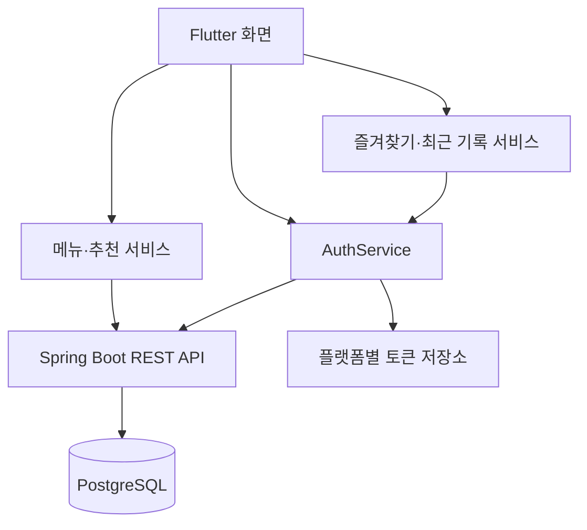

# 🍚 집밥PICK Frontend

> 고민은 짧게, 집밥은 맛있게.

<p align="center">
  
</p>

오늘 먹을 메뉴를 고르고 레시피를 확인하는 **집밥PICK**의 Flutter 앱입니다. <br>
Spring Boot API와 연동해 메뉴 탐색·추천, 회원 인증, 즐겨찾기와 최근 본 레시피를 제공합니다.

**로그인 상태 유지 · 회원별 기록 조회 · 화면 이동 후 데이터 갱신**을 중심으로 구현했습니다. <br>
Android 에뮬레이터와 Chrome에서 로컬 백엔드에 연결해 개발합니다.

[백엔드 저장소](https://github.com/hyeseon1020/zipbob_back) · [앱 코드](lib) · [테스트 코드](test)

[핵심 기능](#-핵심-기능) · [서비스 구조](#-서비스-구조) · [주요 설계](#-주요-설계) · [코드 점검과 테스트](#-코드-점검과-테스트) · [기술 스택](#-기술-스택) · [로컬 실행](#-로컬-실행)

<br>

## 📌 핵심 기능

- **비회원:** 메뉴 검색·추천·레시피 조회
- **로그인 회원:** 즐겨찾기·최근 본 레시피·내 정보 관리
- **화면 구성:** Material 3와 공통 색상·폰트 적용, 웹에서도 최대 폭 430의 모바일 화면 유지

| 기능               | 구현 내용                                                               |
| ------------------ | ----------------------------------------------------------------------- |
| 홈·메뉴 검색       | 카테고리 바로가기, 검색어·카테고리별 목록 조회, 메뉴 카드와 이미지 표시 |
| 아무거나 추천      | 추천 후보를 조회하고 무작위 메뉴 표시                                   |
| 조건 추천          | 카테고리 단일·음식 특징 다중 선택, 추천 가능 개수 표시, 조건 초기화     |
| 추천 결과          | 메뉴 이미지·태그 표시, 다시 추천, 조건 변경, 레시피 연결                |
| 레시피 상세        | 메뉴 ID로 재료·조리 순서·인분·시간·난이도·이미지 조회                   |
| 즐겨찾기           | 로그인한 회원의 등록·해제·목록 조회                                     |
| 최근 본 레시피     | 로그인 상태에서 조회 기록 저장·갱신, 최근 목록 표시                     |
| 회원가입·계정 복구 | 이메일 인증 후 회원가입, 아이디 찾기·비밀번호 재설정                    |
| 로그인·내 정보     | 로그인 복원, 토큰 재발급, 내 정보 조회·닉네임 변경·로그아웃             |

<br>

## 📌 서비스 구조

화면은 사용자 입력과 표시 상태를 관리하고, 서비스는 API 통신과 인증 처리를 담당합니다. <br>
개인 기록 요청에는 Bearer JWT를 전달하며, 기록의 소유자와 접근 권한은 백엔드에서 검증합니다.



| 경로                          | 역할                                              |
| ----------------------------- | ------------------------------------------------- |
| `lib/main.dart`               | 테마·모바일 화면 폭 설정, 기기 등록과 로그인 복원 |
| `lib/screens/`                | 홈·메뉴·추천·레시피·인증·내 정보 화면             |
| `lib/services/`               | API 호출, 공통 인증 처리, 토큰 저장, 기기 등록    |
| `lib/models/`                 | 메뉴·공통코드·기기 등 API 응답 변환               |
| `lib/utils/` · `lib/widgets/` | 필터 계산 로직·재사용 UI                          |

<br>

## 📌 주요 설계

### 1. 토큰 재발급 중복 방지와 로그인 상태 관리

여러 API 요청이 동시에 `401`을 받으면 같은 Refresh Token으로 재발급을 반복할 수 있습니다. <br>
**진행 중인 재발급 작업을 공유**하도록 인증 요청을 `AuthService`에 모았습니다.

- **인증 요청:** GET·PUT·DELETE 요청에 Access Token을 전달합니다.
- **재발급:** `401` 응답 시 토큰을 갱신하고 원래 요청을 한 번 재시도합니다.
- **동시 요청:** 다른 요청이 이미 토큰을 갱신했다면 새 토큰을 사용합니다.
- **상태 변경:** 로그인 시도·로그아웃 전후를 구분해 이전 비동기 응답이 현재 상태를 덮어쓰지 않도록 검사합니다.
- **저장 순서:** 토큰 저장·삭제를 순서대로 처리합니다.

| 환경   | 저장 방식                | 로그인 유지                   |
| ------ | ------------------------ | ----------------------------- |
| 모바일 | `flutter_secure_storage` | 앱 시작 시 저장된 로그인 복원 |
| 웹     | 메모리                   | 새로고침 시 다시 로그인 필요  |

로그아웃은 로컬 토큰을 삭제하고 서버에 Refresh Token 폐기를 요청합니다. 서버 처리가 완료되지 않으면 기기에서의 로그아웃과 서버 해제 실패를 구분해 안내합니다.

[인증 처리](lib/services/auth_service.dart) · [토큰 저장](lib/services/auth_token_store.dart)

<br>

### 2. 회원별 기록과 화면 갱신

즐겨찾기와 최근 기록은 **로그인한 회원 기준**으로 조회합니다. <br>
개인 API에 `userDeviceId`를 전달하던 방식에서 JWT 인증 요청으로 변경했습니다.

| 상황                      | 처리 방식                                                    |
| ------------------------- | ------------------------------------------------------------ |
| 비회원 목록 조회          | 개인 목록 API를 호출하지 않고 빈 목록 반환                   |
| 비회원 레시피 조회        | 상세 조회는 허용하고 최근 기록은 저장하지 않음               |
| 즐겨찾기 등록·해제        | 인증된 PUT·DELETE 요청 전송                                  |
| 상세·즐겨찾기에서 홈 복귀 | 관련 목록을 서버에서 다시 조회                               |
| 닉네임 변경               | 서버 응답으로 회원 정보 갱신, 이전 조회 응답의 덮어쓰기 방지 |

화면 복귀를 갱신 시점으로 사용해 변경된 즐겨찾기와 최근 기록을 반영합니다. 이 방식은 복귀할 때 추가 조회가 발생합니다.

앱 시작 시 UUID 기반 기기 등록은 유지하지만, 즐겨찾기·최근 기록의 소유자를 결정하는 기준은 회원 인증입니다.

[즐겨찾기](lib/services/like_service.dart) · [최근 기록](lib/services/recent_recipe_service.dart) · [내 정보](lib/screens/account_screen.dart)

<br>

### 3. 메뉴 ID를 기준으로 추천과 상세 연결

목록·추천 결과·즐겨찾기에서 선택한 `menuId`로 같은 상세 API를 호출합니다. <br>
화면별 예시 데이터를 전달하는 대신 **서버의 레시피 정보**를 표시합니다.

추천 결과는 서버에서 받은 후보 중 하나를 무작위로 선택합니다. 후보가 여러 개이면 다시 추천할 때 현재 메뉴와 다른 메뉴를 고릅니다. 전체 추천 이력의 중복을 제거하는 방식은 아닙니다.

[레시피 상세](lib/screens/recipe_screen.dart) · [추천 결과](lib/screens/recommend_result_screen.dart)

<br>

### 4. 이메일 인증 공통화와 목적 구분

회원가입·아이디 찾기·비밀번호 재설정에서 인증번호 발송·확인을 공통 서비스로 처리합니다.

| 작업            | 인증 목적        |
| --------------- | ---------------- |
| 회원가입        | `SIGNUP`         |
| 아이디 찾기     | `FIND_ID`        |
| 비밀번호 재설정 | `RESET_PASSWORD` |

인증 완료 후 받은 `verificationToken`을 후속 요청에 포함합니다. 인증 대상 입력이 바뀌면 기존 인증 상태를 초기화하고, 화면에서 유효시간·재발송 대기·중복 요청을 관리합니다. 인증 증명의 목적·만료·사용 여부는 백엔드에서 최종 검증합니다.

[계정 복구 화면](lib/screens/account_recovery_screen.dart)

<br>

## 📌 코드 점검과 테스트

```bash
flutter analyze
flutter test test/api_connection_test.dart
```

| 항목             | 현재 범위                                                                  |
| ---------------- | -------------------------------------------------------------------------- |
| API 연결 테스트  | 실제 백엔드의 `GET /api/test` 호출, 서버와 테스트 데이터 필요              |
| 기존 위젯 테스트 | 기기 등록 이전의 화면 진입 흐름을 가정해 현재 초기화 구조에 맞춘 보완 필요 |
| 후속 검증        | API 모킹, 로그인 복원·동시 재발급·계정 전환·주요 화면 흐름 자동 테스트     |

API 연결 테스트를 호스트 PC에서 실행할 때는 [ApiService](lib/services/api_service.dart)의 `baseUrl`을 `http://localhost:8080/api/test`로 설정합니다.

위 명령은 점검 방법이며, 이번 README 정리에서 Flutter 분석·테스트를 실행한 결과는 아닙니다. <br>
서버의 인증·동시성·DB·파일 처리 테스트와 GitHub Actions 결과는 [백엔드 README](https://github.com/hyeseon1020/zipbob_back#-테스트와-ci)에서 확인할 수 있습니다.

<br>

## 📌 기술 스택

| 구분             | 기술                                               |
| ---------------- | -------------------------------------------------- |
| 앱·UI            | Flutter · Dart · Material 3 · GmarketSans          |
| API 통신         | `http`                                             |
| 상태 관리        | `ChangeNotifier` · `FutureBuilder` · `setState`    |
| 인증 토큰 저장   | `flutter_secure_storage` · 웹 메모리 저장          |
| 기기 등록        | `uuid` · `shared_preferences` · `device_info_plus` |
| 코드 점검·테스트 | `flutter_lints` · `flutter_test`                   |
| 연동 서버        | Spring Boot · PostgreSQL                           |

<br>

## 📌 로컬 실행

[pubspec.yaml](pubspec.yaml)의 Dart SDK 제약 `^3.13.4`를 충족하는 Flutter SDK와 Android 에뮬레이터 또는 Chrome이 필요합니다. <br>
백엔드는 DB·메뉴·공통코드·이미지를 준비한 뒤 실행합니다. 이메일 인증을 확인하려면 서버의 SMTP 설정도 필요합니다.

```bash
git clone https://github.com/WONDongin/zipbob_app.git
cd zipbob_app
flutter pub get
flutter run
```

Chrome 실행:

```bash
flutter run -d chrome --web-port 3000
```

| 실행 환경          | 백엔드 주소                                     |
| ------------------ | ----------------------------------------------- |
| Chrome             | `http://localhost:8080`                         |
| Android 에뮬레이터 | `http://10.0.2.2:8080`                          |
| 실제 휴대폰        | 같은 네트워크에서 접근 가능한 개발 PC의 IP 주소 |

앱은 시작 시 기기 등록이 완료된 뒤 홈에 진입하므로 백엔드가 실행 중이어야 합니다. Chrome 테스트는 백엔드 CORS에 `http://localhost:3000`이 허용되어 있어야 합니다.

<details>
<summary>추가 설정과 현재 범위</summary>

- API 주소는 `UserDeviceService` 외에도 메뉴·코드·추천 서비스와 일부 화면에 선언되어 있습니다. 서버 주소 변경 시 관련 선언을 함께 수정해야 합니다.
- 실제 기기에서는 백엔드 포트와 이미지 URL에 접근할 수 있어야 합니다.
- 현재는 로컬 개발 환경 기준이며, API 주소 공통화·개발/배포 환경 분리·자동 테스트 보완·Android 출시 준비가 후속 작업입니다.

</details>
